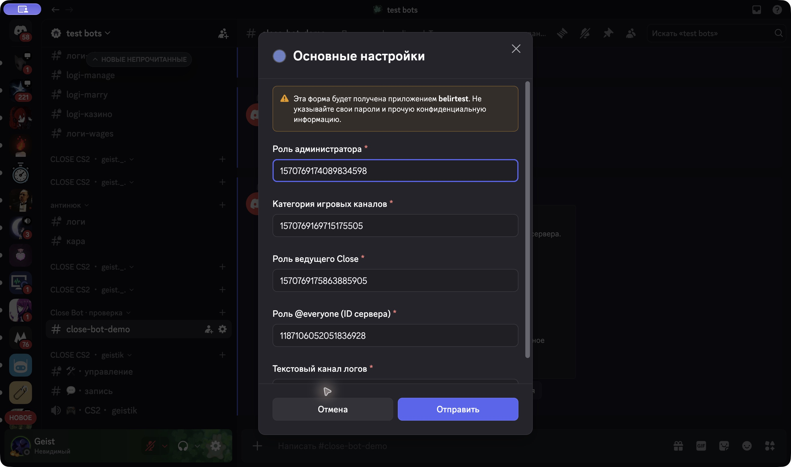
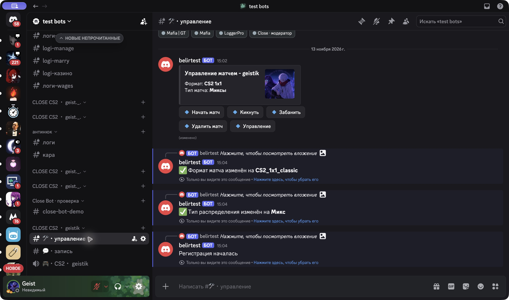
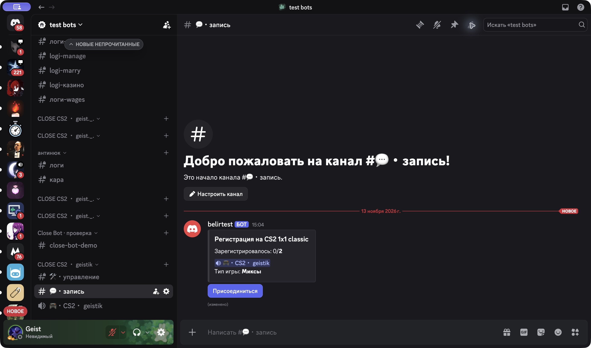

<div align="center">

# Close Bot

**Организация игровых матчей прямо в Discord.**

CS2 · Dota 2 · Valorant

[](https://www.python.org/)
[](https://docs.disnake.dev/)
[](https://github.com/Geist-dev/close-discord/actions/workflows/tests.yml)
[](LICENSE)

[Запуск одной командой](#быстрый-запуск) · [Пошаговый запуск](#пошаговый-запуск) · [Настройка Discord](#подготовка-discord) · [Скриншоты](#скриншоты)

</div>

## Что делает бот

Close Bot помогает ведущему собрать игроков, выбрать формат матча и организовать игровые каналы. Состояние матчей, роли и настройки хранятся локально в SQLite. Команды и кнопки работают через Discord API; ключи AI-моделей и платные AI-сервисы не нужны.

- `/config` — настройка ролей и каналов в трёх разделах с проверкой ID.
- `/close create` — выбор CS2, Dota 2 или Valorant.
- Отдельные каналы управления, записи и голосового общения для матча.
- Выбор формата и распределения: миксы или капитаны; отдельная регистрация Dota 2 по позициям.
- Кнопки регистрации, управления игроками и матчем.
- Closeban с ограниченным сроком и автоматическим снятием роли.
- Сохранение таймера при сбое Discord, чтобы повторить снятие ограничения.
- Режим тестового сервера без обработки событий других серверов и изменения глобальных slash-команд.

## Подготовка Discord

Настройка приложения и получение токена выполняются один раз.

1. Откройте [Discord Developer Portal](https://discord.com/developers/applications), создайте приложение или выберите своё.
2. В разделе **Bot** получите токен. Сохраните его только в локальном `.env`; не вставляйте в README, код, скриншоты, issues или сообщения чата. Если токен раскрыт — замените через **Reset Token**.
3. В **Bot → Privileged Gateway Intents** включите **Server Members Intent**. Message Content и Presence для этой версии не требуются.
4. В **Installation / OAuth2 URL Generator** выберите установку на сервер со scopes **bot** и **applications.commands**.
5. Выдайте боту необходимые права: View Channels, Send Messages, Embed Links, Read Message History, Manage Channels, Manage Roles, Move Members, Mute Members, Connect, Manage Events и View Audit Log. Для тестирования используйте отдельный сервер.
6. Добавьте бота на сервер. Поднимите его роль выше тех ролей, которыми он будет управлять. Права Administrator для обычной работы не обязательны.
7. Включите **User Settings → Advanced → Developer Mode**: это позволит копировать ID сервера, каналов и ролей.

Актуальные инструкции: [токен бота](https://support-dev.discord.com/hc/en-us/articles/6470840524311-Why-can-t-I-copy-my-bot-s-token), [Discord Gateway Intents](https://docs.discord.com/developers/events/gateway#gateway-intents).

## Требования

- Python **3.11–3.14**, включая `venv`.
- Git для клонирования.
- Интернет для установки зависимостей и подключения к Discord.
- macOS/Linux или Git Bash на Windows для bash-скрипта. Для PowerShell предусмотрен ручной вариант.

Бот управляет голосовыми каналами, но не подключается к голосу и не воспроизводит аудио. Предупреждение об отсутствии PyNaCl / dave.py для этих функций не мешает работе.

## Быстрый запуск

В терминале:

```bash
git clone https://github.com/Geist-dev/close-discord.git
cd close-discord
bash start.sh
```

При первом запуске скрипт создаст `.venv`, установит зависимости и подготовит приватный `.env`. Запуск без токена завершится с понятным сообщением.

Откройте `.env` в локальном редакторе, заполните:

```dotenv
TOKEN=REPLACE_WITH_BOT_TOKEN
TEST_GUILD_IDS=YOUR_TEST_SERVER_ID
DATABASE_PATH=.data/users.db
```

Замените заглушки своими значениями. Затем всё запускается **одной командой**:

```bash
bash start.sh
```

Существующий `.env` не перезаписывается. Для выбора Python можно использовать `PYTHON=python3.12 bash start.sh`. Остановка — **Ctrl+C**.

Чтобы проверить загрузку всех модулей **без токена и подключения к Discord**:

```bash
bash start.sh --check
```

## Пошаговый запуск

### macOS / Linux / Git Bash

**1. Клонируйте проект.**

```bash
git clone https://github.com/Geist-dev/close-discord.git
cd close-discord
```

**2. Создайте и активируйте окружение.**

```bash
python3 -m venv .venv
source .venv/bin/activate
```

В Git Bash на Windows: `python -m venv .venv`, затем `source .venv/Scripts/activate`. Если Linux сообщает об отсутствии `venv`, установите пакет `python3-venv` через пакетный менеджер системы.

**3. Установите зависимости.**

```bash
python -m pip install -r requirements.txt
```

**4. Подготовьте приватную конфигурацию.**

```bash
python scripts/setup_env.py
```

Заполните `TOKEN` и `TEST_GUILD_IDS` в созданном `.env`. [`.env.example`](.env.example) содержит только заглушки.

**5. Проверьте модули без подключения к сети.**

```bash
python main.py --check
```

Ожидаемый результат: `CHECK OK: database ready, 23 extensions loaded; no Discord login.`

**6. Запустите бота.**

```bash
python main.py
```

Дождитесь `Close Bot connected`. В Discord вызовите `/config`, затем `/close create`. Если на сервере есть другой бот с такими же командами, выбирайте команду именно вашего приложения.

### Windows PowerShell

Активация окружения и изменение политики PowerShell не требуются:

```powershell
git clone https://github.com/Geist-dev/close-discord.git
cd close-discord
py -3 -m venv .venv
.\.venv\Scripts\python.exe -m pip install -r requirements.txt
.\.venv\Scripts\python.exe scripts/setup_env.py
```

Заполните `.env` в редакторе, затем:

```powershell
.\.venv\Scripts\python.exe main.py --check
.\.venv\Scripts\python.exe main.py
```

## Настройка на сервере

`/config` доступна пользователям с правом **Manage Server / Управление сервером**. Права повторно проверяются при открытии и отправке формы. Чужие роли и каналы не принимаются. Каждый раздел сохраняет только свои поля.

| Раздел | Что указать |
| --- | --- |
| Основные настройки | Роль администратора, существующая категория как ориентир размещения матчей, роль ведущего, ID @everyone (равен ID сервера), текстовый канал логов |
| Игры и ограничения | Роль Closeban, второй журнал, игровые роли CS2 / Dota 2 / Valorant |
| Модерация | Роль старшего модератора и журнал управления ролями |

Значение `0` отключает необязательный параметр. Для создания матчей настройте категорию и роль ведущего. Для Closeban дополнительно нужна роль ограничения и подходящие права бота. Ведущий получает доступ через настроенную роль; пользователи с Manage Server также могут создать матч.

После `/close create` выберите игру, перейдите в созданный канал **управления**, выберите формат и тип распределения, нажмите **Подтвердить**. В канале **записи** появится регистрация участников.

## Скриншоты

Ниже — настоящие снимки Discord при работе бота на отдельном тестовом сервере. Токен и содержимое `.env` в них не показаны.

| Форма параметров | Панель матча |
| --- | --- |
|  |  |



## Конфигурация и хранение

| Параметр | Назначение |
| --- | --- |
| `TOKEN` | Приватный Discord bot token |
| `TEST_GUILD_IDS` | ID тестовых серверов через запятую. В этом режиме команды синхронизируются только для них, события других серверов игнорируются, глобальные команды не изменяются |
| `DATABASE_PATH` | SQLite, по умолчанию `.data/users.db`. Относительный путь разрешается от корня репозитория |

Пустой `TEST_GUILD_IDS` включает обычный режим для серверов, где установлен бот. На время разработки задавайте тестовый сервер, чтобы не менять глобальные команды приложения.

`.env`, `.venv`, SQLite и локальные данные исключены из Git. Не добавляйте их принудительно. Для резервной копии остановите бота и сохраните базу данных отдельно. Не запускайте несколько экземпляров с одной БД и токеном.

Если у вас есть база прежней версии в `dbs/users.db`, сделайте резервную копию и укажите `DATABASE_PATH=dbs/users.db`. Однобайтовый файл-заглушка из старого репозитория не является рабочей SQLite-базой; новую базу приложение создаёт самостоятельно.

## Структура

```text
main.py              запуск, загрузка модулей, изоляция тестовых серверов
settings.py          приватная конфигурация и пути
cogs/                команды, компоненты, матчи, фоновые задачи
utils/databases.py   SQLite и настройки серверов
scripts/setup_env.py  подготовка локального .env
start.sh             подготовка окружения и запуск
tests/               автономные регрессионные проверки
docs/screenshots/    снимки реального Discord
```

## Проверки

```bash
python -m pip install -r requirements-dev.txt
python -m pytest -q
python main.py --check
```

Тесты работают без токена и Discord, используют временные БД и проверяют загрузку модулей, сохранение разделов настроек, права доступа, проверку ID, сроки Closeban, изоляцию серверов и повторную попытку снятия роли при сбое Discord. GitHub Actions запускает их на Python 3.11, 3.12 и 3.14.

## Ограничения

- На тестовом сервере проверены подключение, `/config`, создание матча CS2, выбор формата, публикация регистрации, запись ведущего и выход. Полный матч с несколькими игроками и живой сценарий Dota 2 не проверялись; автономные тесты не заменяют такую проверку.
- SQLite и часть логики участия используют ID участника глобально: одновременное участие одного человека в нескольких матчах разных серверов не поддерживается.
- Активные меню выбора создаются в памяти. После перезапуска бота меню уже открытых матчей могут потребовать пересоздания; восстановление всех UI-компонентов из БД пока не реализовано.
- Автоматическое снятие Closeban проверяется раз в минуту и требует доступа к серверу, участнику и роли. При ошибке запись сохраняется для повтора; удалённая/ненастроенная роль требует внимания администратора.
- Роль Closeban должна действительно ограничивать доступ через права каналов. Она не заменяет серверный Discord ban.
- Параллельные нажатия и сбои во время создания/удаления каналов требуют дополнительного тестирования перед использованием на крупном сервере.

## Если возникла ошибка

- **LoginFailure:** проверьте токен в локальном `.env`; после Reset Token прежний не действует.
- **PrivilegedIntentsRequired:** включите Server Members Intent в Developer Portal.
- **Команды не видны:** проверьте ID в `TEST_GUILD_IDS`, scope `applications.commands`, права участника и выбранное приложение. Перезагрузите Discord после синхронизации.
- **Не создаются каналы или не выдаются роли:** проверьте права бота, ID категории и положение его роли.
- **Потерян доступ к форме настройки:** нужен Manage Server; вызовите `/config` заново после изменения прав.

## Лицензия и авторство

**Copyright (c) 2025–2026 Geist-dev.** Исходный проект: [Geist-dev/close-discord](https://github.com/Geist-dev/close-discord).

[MIT License](LICENSE) разрешает использование, изменения, распространение и коммерческое использование при сохранении уведомления об авторских правах **Geist-dev** и текста лицензии в копиях или существенных частях проекта. Постоянная подпись в интерфейсе не обязательна. Права на чужие изменения не переходят к автору исходного проекта.

---

[Geist-dev](https://github.com/Geist-dev) · [Telegram](https://t.me/flipgood)
